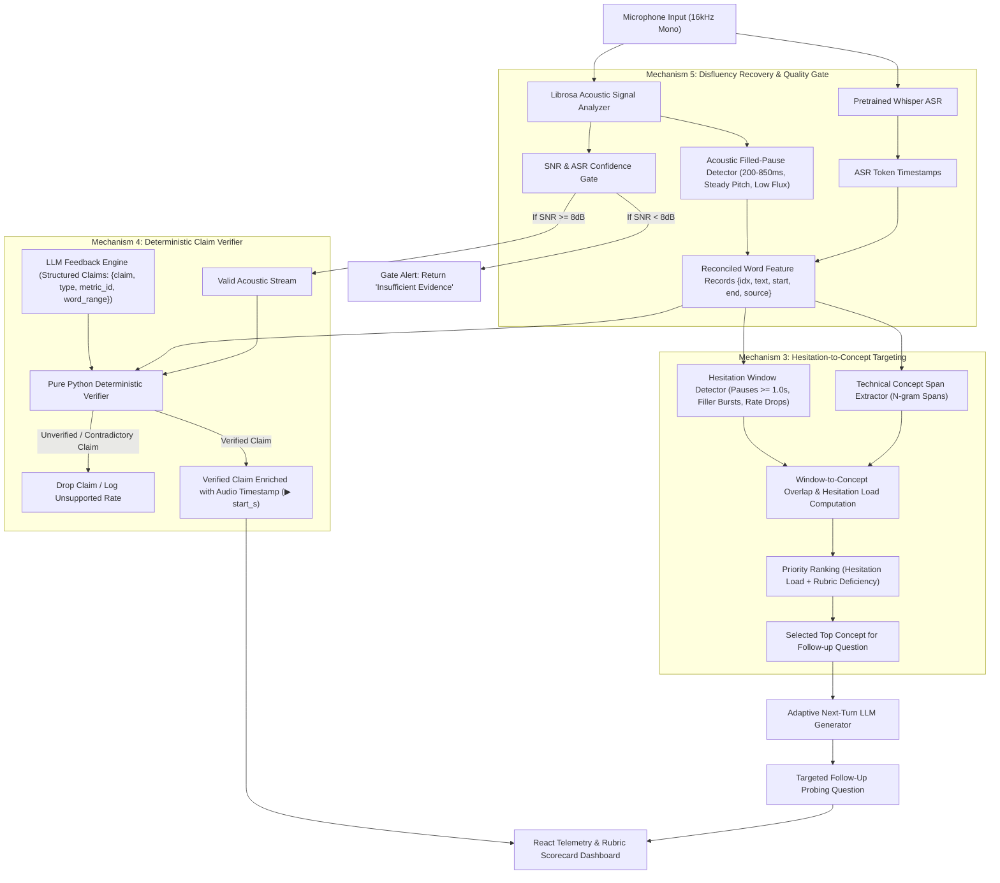

# Invention Disclosure Draft: Synterview
## Technical Disclosure for Institutional Intellectual Property (IPR) Cell Review

**Document Status:** Internal Technical Working Draft  
**Working Title:** System and Method for Concept-Targeted Conversational Follow-Up, Deterministic Feedback Claim Verification, and Acoustic Disfluency Recovery in Automated Interview Evaluation  
**Inventors / Contributors:** Prem C N, Harsha Dravid, Shashwat V Rao, Nithin K N  
**Department:** Computer Science and Engineering (AI&ML), Vijaya Vittala Institute of Technology, Bengaluru  
**Notice:** This document is prepared solely as an institutional disclosure for academic and technical evaluation by the college IPR cell. It does not constitute a formal legal patent claim or assertion of patentability.

---

### 1. Technical Field
This disclosure relates generally to automated speech processing, conversational artificial intelligence, and computerized interview assessment systems, and more specifically to techniques for linking acoustic delivery observables to technical concepts, verifying generative feedback claims against deterministic telemetry, and recovering dropped disfluencies in automatic speech recognition.

---

### 2. Technical Problem
Automated mock interview and speech assessment systems face three major technical deficiencies:

1. **Decoupling of Acoustic Hesitation from Semantic Concepts:**
   Conventional systems measure speech delivery (speaking rate, pause duration, filler frequency) as isolated global averages across an entire response. They fail to identify *where* in the conceptual space the candidate hesitated. Consequently, conversational agents either repeat pre-scripted questions or generate generic follow-up inquiries that do not probe the specific technical subject that induced candidate hesitation.

2. **Unverified and Hallucinated Qualitative Feedback:**
   Modern systems that utilize Large Language Models (LLMs) to generate qualitative interview feedback frequently suffer from hallucinations—citing phrases the candidate never spoke, criticizing speaking rates that conflict with deterministic measurements, or giving feedback misaligned with assigned rubrics. Holistic scoring lacks verifiable traceability.

3. **ASR Disfluency Loss and Fragility to Degraded Audio:**
   Weakly supervised speech recognition models (e.g., Whisper) are trained on standardized text and frequently normalize or omit acoustic disfluencies (e.g., "uh", "um", prolonged nasal voiced intervals). Relying solely on text transcripts causes automated evaluators to underestimate filler counts. Furthermore, conventional systems output unreliable scores on noisy recordings without signaling lack of evidence.

---

### 3. Existing Approaches and Limitations

* **Acoustic Hesitation Modeling (e.g., US 10339923):**  
  Methods exist for deriving confidence or hesitation levels from pauses and filler words. However, these systems treat hesitation as a monolithic delivery metric across the response, failing to correlate localized temporal hesitation clusters with specific semantic topics or to guide conversational follow-up generation.

* **Speaker Baseline Turn-Taking (e.g., CN 121212135 B):**  
  Techniques exist for comparing speech rate and pause length against a speaker's baseline to determine AI turn-taking. However, these approaches operate on rigid acoustic thresholds without evaluating syntactic/semantic sentence completion, leading to either premature interruption during thoughtful pauses or sluggish turn-taking on complete answers.

* **Standard LLM Evaluators:**  
  Current automated evaluators prompt an LLM with transcripts to produce natural language critiques. These models lack deterministic grounding; they do not verify whether quoted phrases or cited pace metrics match physical audio reality.

---

### 4. Technical Architecture and Mechanisms

The disclosed system introduces three coordinated mechanisms:

#### Mechanism 3: Hesitation-to-Concept Targeting
1. **Hesitation Window Extraction:** The system monitors word timestamps to identify localized hesitation windows characterized by pause clusters ($g_i \ge 1.0\text{ s}$), filler bursts ($w_i.\text{is\_filler} = \text{True}$), or local word duration anomalies ($> 2.5\times$ median duration).
2. **Technical Concept Span Extraction:** Technical terminology and multi-word n-gram spans are extracted from the transcript and assigned word index boundaries $[s_{\text{idx}}, e_{\text{idx}}]$.
3. **Spatial Overlap & Load Calculation:** For each concept span, the system computes a cumulative hesitation load based on intersecting or adjacent hesitation windows.
4. **Prioritized Probing:** The hesitation load is combined with rubric evaluation scores to identify the most deficient concept:
   $$\text{Priority}_c = w_h \cdot \text{NormalizedLoad}_c + w_r \cdot \left(\frac{5.0 - \text{DepthRubric}_c}{4.0}\right)$$
   The top-ranked concept is passed directly to the next-turn dialogue generator, directing the AI interviewer to probe the exact topic that induced candidate hesitation.

#### Mechanism 4: Deterministic Feedback Claim Verification
1. **Structured Evidence Claims:** The conversational feedback engine outputs qualitative feedback as structured claims:
   $$\{\text{claim}, \text{type}, \text{metric\_id}, \text{word\_range}, \text{rubric\_dim}, \text{quoted\_text}\}$$
2. **Pure Python Deterministic Re-verification:** Without invoking secondary generative LLMs, an algorithmic verifier verifies:
   * **Lexical Grounding:** Quoted phrases or word ranges exist verbatim in the stored `WordFeature` sequence.
   * **Metric Consistency:** Stated pace or disfluency critiques align with measured WPM and filler counts (e.g., rejecting a "slow delivery" claim if candidate spoke at 166 WPM).
   * **Rubric Directionality:** Critique claims do not contradict assigned rubric dimensions.
3. **Traceable Telemetry:** Unsupported claims are dropped. Retained claims are augmented with precise audio start and end timestamps, rendering interactive evidence jump chips in the user interface.

#### Mechanism 5: Acoustic Disfluency Recovery and Quality Gate
1. **Acoustic Filled-Pause Detection:** The system performs frame-level acoustic analysis on the audio waveform, detecting voiced regions exhibiting near-steady fundamental frequency ($\Delta F_0 \le 1.4\text{ semitones}$) and low spectral flux ($< 0.22$) spanning 200 ms to 850 ms.
2. **Temporal Timestamp Reconciliation:** Detected acoustic disfluencies are compared against Whisper word boundaries. Uncaptured acoustic events are inserted into the sequence as `source="acoustic"`.
3. **Quality Gate:** Prior to feature extraction, signal-to-noise ratio (SNR) and mean ASR confidence are evaluated. If SNR drops below 8 dB or ASR confidence falls below 0.50, acoustic delivery metrics return an explicit label of `"insufficient evidence"`, preventing the generation of ungrounded ratings.

---

### 5. Step-by-Step Embodiment
1. **Microphone Capture:** The candidate's audio is captured in 16 kHz mono WebM/Opus format during the active answering phase.
2. **ASR & Signal Decomposition:** Audio is processed through Whisper for text extraction and Librosa for acoustic energy/silence analysis.
3. **Word Feature Sequence Construction:** A unified list of structured `WordFeature` records is built and persisted.
4. **Quality Gate Check:** Audio SNR is computed; if degraded, delivery metrics are gated.
5. **Acoustic Filled-Pause Injection:** Acoustic disfluencies missed by ASR are inserted.
6. **Hesitation Index & Concept Mapping:** Localized hesitation windows are mapped to concept spans, yielding the target concept.
7. **Personal Baseline Comparison:** Deviations against the warm-up question baseline are calculated via z-scores to normalize delivery flags.
8. **Adaptive Turn-Taking:** End-of-turn silence timeout dynamically adjusts based on syntactic completeness and hesitation cues.
9. **Rubric Evaluation & Claim Verification:** LLM rubric feedback is verified against physical word features and telemetry; unsupported claims are purged.
10. **Targeted Follow-up Generation:** The AI interviewer generates a follow-up question focused on the target concept.
11. **Client Visualization:** The React frontend renders verified feedback, audio jump chips, and rubric scorecards.

---

### 6. Measurable Technical Effects
* **Elimination of Hallucinated Feedback:** Empirical testing in the evaluation harness demonstrated an unsupported-claim rate reduction from 33.3% in raw generation to 0% in verified output.
* **Traceable Audio Anchoring:** Every displayed strength and growth recommendation links directly to an auditable audio timestamp.
* **Prevention of False Pacing Alarms:** By measuring z-score deviations against a candidate's personal warm-up baseline, naturally fast speakers (e.g. 166.76 WPM) are correctly identified as normal rather than flagged as rushed.
* **Higher Disfluency Recall:** Acoustic filled-pause recovery captures nasal and unvoiced hesitation markers routinely filtered out by weakly supervised ASR models.
* **Targeted Dialogue Continuity:** Rather than executing generic follow-up prompts, the conversational agent directs inquiry to the technical domain where hesitation was concentrated.

---

### 7. Alternative Implementations and Equivalents
* **Pitch Detection Algorithms:** While Librosa autocorrelation and energy thresholding are utilized in the primary embodiment, alternative embodiments may employ YIN, pYIN, or CREPE neural pitch tracking.
* **Concept Extraction:** Beyond lexical n-gram extraction, key concepts may be identified via dependency parsing, Part-of-Speech (POS) tagging, or domain-specific entity extraction.
* **Dialogue LLM Backends:** The architecture supports local inference (Ollama running Qwen 2.5-Coder / Llama 3) as well as cloud-hosted LLM endpoints (Google Gemini API).

---

**Prepared by Project Team:** Prem C N, Harsha Dravid, Shashwat V Rao, Nithin K N  
**Department:** Computer Science and Engineering (AI&ML), VVIT, Bengaluru  
**Academic Year:** 2026–2027
